## Hi! I'm Karina

I'm a **Java Backend Developer**.

### About :octocat:
- Backend-first engineer with strong Java / Spring Boot fundamentals  
- I work comfortably with both relational and non-relational databases (SQL, schema design, migrations)  
- Care about tests and often work TDD-style - unit + integration with JUnit, Mockito, and Testcontainers
- Used to packaging and shipping with Docker and CI (GitHub Actions, Jenkins)
- Hands-on with observability: Spring Actuator, Prometheus, and Grafana (metrics + alerts)
- Use AI as a coding assistant to move faster, not as a substitute for understanding the code

## Tech stack
**Backend:** Java 21 · Spring Boot (MVC, Security, Data JPA) · Spring Cloud (Gateway, Eureka, OpenFeign) · Hibernate · Kafka · WebSocket · Maven  
**Data:** PostgreSQL · MySQL · MongoDB · Redis · Elasticsearch · Flyway  
**Quality & delivery:** JUnit · Mockito · Testcontainers · AWS · OpenAPI/Swagger · Git · GitHub Actions · Jenkins · Docker · Kubernetes  
**Frontend (supporting):** React · JavaScript · HTML/CSS  
**Interested in:** Kotlin · System design

<table>
  <tr>
    <td></td>
    <td></td>
    <td></td>
    <td></td>
    <td></td>
    <td></td>
    <td></td>
    <td></td>
    <td></td>
    <td></td>
    <td></td>
    <td></td>
    <td></td>
    <td></td>
    <td></td>
  </tr>
</table>

### 📌 Currently working on
Focused on taking **Book Reviewer** from local/Docker into a real **AWS** deployment (wiring the app, supporting services, and monitoring so it runs outside my machine).  

  
  

---
